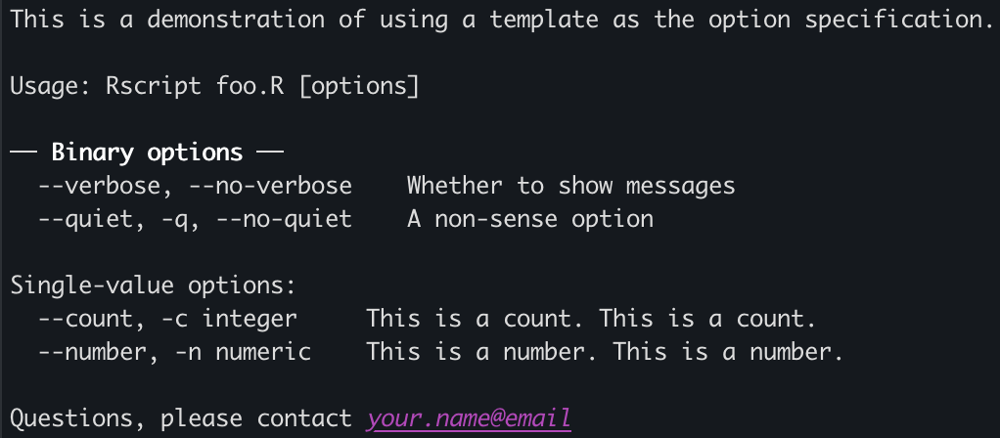

# Customizing help messages

    ## Warning: package 'knitr' was built under R version 4.6.1

------------------------------------------------------------------------

## Automatically generat help message

The help message is automatically generated according to the argument
specifications. The following code shows the help message from scalar
arguments.

``` r

argitect(
    "number=i", "Number of items.",
    "cutoff=f", "Cutoff for filtering results.",
    "verbose!", "Print messages.",
    "file=s#",  "Input file."
)
```

For each argument, it prints the full argumnet name (as well as the
alias names if they are provided), the data mode, the flag letter (if
the first letter is unique). Positional argument name is marked by `<>`
which means the name is not necessary to specify. Positional argument is
explicitely added to “Usage” if it is the first or the last option
specified in [`argitect()`](../reference/argitect.md).

Two additional arguments `help` and `verbose` are inserted to the end.

    Usage: Rscript foo.R [options] [file]

    Options:
      --number, -n integer
        Number of items. 
      --cutoff, -c numeric
        Cutoff for filtering results. 
      --verbose, --no-verbose
        Print messages.
        [default: off] 
      <file> character
        Input file. 
      --help, -h
        Print help message and exit. 
      --version
        Print version information and exit. 

For the vector or hash arguments, the data mode text is adjusted
accordingly.

``` r

argitect(
    "number=i@", "Number of items.",
    "cutoff=f%", "Cutoff for filtering results.",
    "file=s#{}", "Input files."
)
```

    Usage: Rscript foo.R [options] [file...]

    Options:
      --number, -n [integer, ...]
        Number of items. 
      --cutoff, -c {name=numeric, ...}
        Cutoff for filtering results. 
      <file> [character, ...]
        Input files. 
      --help, -h
        Print help message and exit. 
      --version, -v
        Print version information and exit. 

When there are constraints on the vector arguments, the range is added
to the data mode text.

``` r

argitect(
    "number1=i@{2,3}", "Number of items.",
    "number2=i@{,3}",  "Number of items.",
    "number3=i@{2,}",  "Number of items.",
    "file=s#{3}",      "Input files."
)
```

    Usage: Rscript foo.R [options] [file...]

    Options:
      --number1 [integer, 2-3]
        Number of items. 
      --number2 [integer, 1-3]
        Number of items. 
      --number3 [integer, 2+]
        Number of items. 
      <file> [character, 3]
        Input files. 
      --help, -h
        Print help message and exit. 
      --version, -v
        Print version information and exit. 

For `@` and `#`, a pre-defined set of names can be added.

``` r

argitect(
    "number1=i@{foo,bar}",  "Number of items.",
    "number2=i@{foo,bar,}", "Number of items.",
    "file=s#{foo,bar}",     "Input files."
)
```

    Usage: Rscript foo.R [options] [file]

    Options:
      --number1 [foo=integer, bar=integer]
        Number of items. 
      --number2 [foo=integer, bar=integer, ...]
        Number of items. 
      <file> [<foo>=character, <bar>=character]
        Input files. 
      --help, -h
        Print help message and exit. 
      --version, -v
        Print version information and exit. 

For `%` with pre-defined names, see [Documenting
sub-arguments](#Documenting_sub-arguments) section.

If default values for some arguments are already provided, they are also
added to the help message.

``` r

number = 2L
cutoff = 0.05
file = "foo.txt"
argitect(
    "number=i", "Number of items.",
    "cutoff=f", "Cutoff for filtering results.",
    "verbose!", "Print messages.",
    "file=s#",  "Input file."
)
```

    Usage: Rscript foo.R [options] [file]

    Options:
      --number, -n integer
        Number of items.
        [default: 2] 
      --cutoff, -c numeric
        Cutoff for filtering results.
        [default: 0.05] 
      --verbose, --no-verbose
        Print messages.
        [default: off] 
      <file> character
        Input file.
        [default: foo.txt] 
      --help, -h
        Print help message and exit. 
      --version
        Print version information and exit. 

## One-column and two-column styles

The default style is one-column. `help_style` can be set to `two-column`
so that in the two-column layout, argument names are in the left column
and descriptions are in the second column.

``` r

argitect(
    "number=i@", "Number of items.",
    "cutoff=f@", "Cutoff for filtering results.",
    "verbose!", "Print messages.",
    help_style = "two-column"
)
```

    Usage: Rscript foo.R [options]

    Options:
      --number, -n [integer, ...]    Number of items. 
      --cutoff, -c [numeric, ...]    Cutoff for filtering results. 
      --verbose, --no-verbose        Print messages.                               
                                     [default: off] 
      --help, -h                     Print help message and exit. 
      --version                      Print version information and exit. 

The style can also be set globally:

``` r

argitect_options("help_style" = "two-column")
```

The argument name column can be controlled by adding a second value to
`help_width`, which controls the width of the first column in the
two-column style.

``` r

argitect(
    "number|a|b|c|d|e|f|g|h|i|j|k|l|m|n=i", "Number of items.",
    "cutoff=f", "Cutoff for filtering results.",
    "verbose!", "Print messages.",
    help_style = "two-column",
    help_width = c(90, 50)
)
```

    Usage: Rscript foo.R [options]

    Options:
      --number, -a, -b, -c, -d, -e, -f, -g, -h,    Number of items.
                -i, -j, -k, -l, -m, -n integer 
      --cutoff numeric                             Cutoff for filtering results. 
      --verbose, --no-verbose                      Print messages.                                             
                                                   [default: off] 
      --help                                       Print help message and exit. 
      --version                                    Print version information and exit. 

## Sections

Arguments can be grouped. A separator line (a name consisting only of
`-`, `=`, `+`, `#` or `%`) starts a new section. Note `help` and
`version` will be added to the last section. If you only want `help` and
`version` in the last section, then simply create an section with the
separator line but with no other argument.

``` r

argitect(
    "number=i", "Number of items.",

    "-------", "Binary options:",
    "verbose!", "Print messages.",
    "quiet!", "Print nothing.",

    "-------", "Other options:",
    "cutoff=f", "Cutoff for filtering results."
)
```

    Usage: Rscript foo.R [options]

      --number, -n integer
        Number of items. 

    Binary options:
      --verbose, --no-verbose
        Print messages.
        [default: off] 
      --quiet, -q, --no-quiet
        Print nothing.
        [default: off] 

    Other options:
      --cutoff, -c numeric
        Cutoff for filtering results. 
      --help, -h
        Print help message and exit. 
      --version
        Print version information and exit. 

## Documenting sub-arguments

For a hash, the description of each sub-argument can be supplied with an
extra specification in the form `parent$sub`:

``` r

argitect(
    "arg=i%{foo, bar}", "This is a hash option.",
    "arg$foo", "The foo part.",  # only for documenting
    "arg$bar", "The bar part."   # only for documenting
)
```

    Usage: Rscript foo.R [options]

    Options:
      --arg, -a {foo=integer, bar=integer}
        This is a hash option.

        Sub named options:
        foo integer
            The foo part.
        bar integer
            The bar part. 
      --help, -h
        Print help message and exit. 
      --version, -v
        Print version information and exit. 

If sub-argument is a vector, the corresponding mode description is
adjusted.

``` r

argitect(
    "arg=%{foo=i@{2,3}, bar=f@{,2}}", "This is a hash option.",
    "arg$foo", "The foo part.",
    "arg$bar", "The bar part."
)
```

    Usage: Rscript foo.R [options]

    Options:
      --arg, -a {foo=[integer, 2-3], bar=[numeric, 1-2]}
        This is a hash option.

        Sub named options:
        foo [integer, 2-3]
            The foo part.
        bar [numeric, 1-2]
            The bar part. 
      --help, -h
        Print help message and exit. 
      --version, -v
        Print version information and exit. 

## Template

A single string is treated as a template, where each command is marked
by the `template_tag` (default `<CODE>`).

``` r

argitect("
This is a demonstration of using a template as the option specification.

Usage: Rscript foo.R [options]

Binary options
  <verbose!> Whether to show messages
  <quiet!> A non-sense option

Single-value options:
  <count=i> This is a count. This is a count.
  <number=f> This is a number. This is a number.

Questions, please contact your.name@email
")
```

    This is a demonstration of using a template as the option specification. 
     
    Usage: Rscript foo.R [options] 
     
    Binary options 
      --verbose, --no-verbose    Whether to show messages
      --quiet, -q, --no-quiet    A non-sense option
     
    Single-value options: 
      --count, -c integer     This is a count. This is a count.
      --number, -n numeric    This is a number. This is a number.
     
    Questions, please contact your.name@email 

Template allows `{{...}}` to contain executable code to interpolate and
to insert into the template.

``` r

argitect("
This is a demonstration of using a template as the option specification.

Usage: Rscript foo.R [options]

{{ cli_h2('Binary options') }}
  <verbose!> Whether to show messages
  <quiet!> A non-sense option

Single-value options:
  <count=i> This is a count. This is a count.
  <number=f> This is a number. This is a number.

Questions, please contact {{ col_magenta(style_underline(style_italic('your.name@email'))) }}
")
```



The width of the argument column is computed per section, so arguments
that are not separated by a blank line are aligned together.

If enough space is preserved before the second line of the description
text block, the text is automatically aligned.

``` r

argitect("
Usage: Rscript foo.R [options]

  <count=i@{2,}> This is a count. This is a count. This is a count.
         This is a count. This is a count.
")
```

    Usage: Rscript foo.R [options] 
     
      --count, -c [integer, 2+]    This is a count. This is a count. This is a
                                   count. This is a count. This is a count.

## Head and foot

`help_head` and `help_foot` are printed before and after the argument
list, in the template as well as in the generated layout.

``` r

argitect(
    help_head = "This is the head of the help message.",
    "number=i", "Number of items.",
    help_foot = "This is the foot of the help message."
)
```

    This is the head of the help message.

    Usage: Rscript foo.R [options]

    Options:
      --number, -n integer
        Number of items. 
      --help, -h
        Print help message and exit. 
      --version, -v
        Print version information and exit. 

    This is the foot of the help message.

## –-help and –-version

`help` and `version` are two reserved logical options. The version
number can be set in a variable `VERSION`.

``` r

VERSION = "0.0.1"
argitect(
    "size=i", "Size."
)
```

    ~\> Rscript foo.R --version

    0.0.1

Their help message can be self-defined.

``` r

argitect(
    "size=i", "Size.",
    "help!", "Help!",
    "version!", "Print version number."
)
```

    Usage: Rscript foo.R [options]

    Options:
      --size, -s integer
        Size. 
      --help, -h, --no-help
        Help!
        [default: off] 
      --version, -v, --no-version
        Print version number.
        [default: off] 

## Session info

``` r

sessionInfo()
```

    R version 4.6.0 (2026-04-24)
    Platform: aarch64-apple-darwin23
    Running under: macOS 27.2.1

    Matrix products: default
    BLAS:   /Library/Frameworks/R.framework/Versions/4.6/Resources/lib/libRblas.0.dylib 
    LAPACK: /Library/Frameworks/R.framework/Versions/4.6/Resources/lib/libRlapack.dylib;  LAPACK version 3.12.1

    locale:
    [1] en_GB.UTF-8/en_GB.UTF-8/en_GB.UTF-8/C/en_GB.UTF-8/en_GB.UTF-8

    time zone: Asia/Shanghai
    tzcode source: internal

    attached base packages:
    [1] stats     graphics  grDevices utils     datasets  methods   base     

    other attached packages:
    [1] argitect_0.1.0 knitr_1.52    

    loaded via a namespace (and not attached):
     [1] digest_0.6.39       desc_1.4.3          R6_2.6.1           
     [4] GlobalOptions_0.1.4 fastmap_1.2.0       xfun_0.62          
     [7] cachem_1.1.0        htmltools_0.5.9     rmarkdown_2.32     
    [10] lifecycle_1.0.5     cli_3.6.6           sass_0.4.10        
    [13] pkgdown_2.2.1       textshaping_1.0.5   jquerylib_0.1.4    
    [16] systemfonts_1.3.2   compiler_4.6.0      tools_4.6.0        
    [19] ragg_1.5.2          bslib_0.12.0        evaluate_1.0.5     
    [22] yaml_2.3.12         otel_0.3.0          jsonlite_2.0.0     
    [25] rlang_1.3.0         fs_2.1.0            htmlwidgets_1.6.4  
