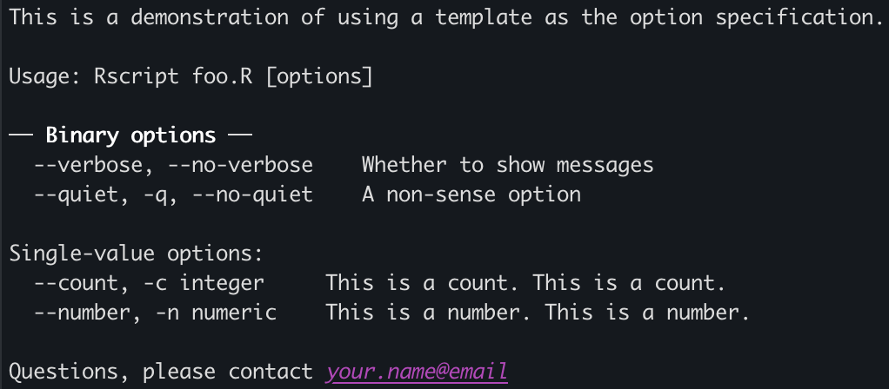

```{r, echo = FALSE, message = FALSE}
library(knitr)
knitr::opts_chunk$set(
    error = FALSE,
    tidy  = FALSE,
    warning = FALSE,
    message = FALSE,
    comment = NA,
    fig.align = "center")
library(argitect)

options(cli.num_colors = 1)

run_code = function(code_block, argv_str) {
    chunks = knitr:::knit_code$get()
    argitect_options("__argv_str__" = argv_str)
    local({ 
        for(cb in code_block)
            eval(parse(text = chunks[[cb]])) 
    })
    argitect_options(RESET = TRUE)
}
```

------------------------------------------------------------------------

## Automatically generat help message

The help message is automatically generated according to the argument specifications.
The following code shows the help message from scalar arguments.

```{r default, eval = FALSE}
argitect(
    "number=i", "Number of items.",
    "cutoff=f", "Cutoff for filtering results.",
    "verbose!", "Print messages.",
    "file=s#",  "Input file."
)
```

For each argument, it prints the full argumnet name (as well as the alias names if they are
provided), the data mode, the flag letter (if the first letter is unique).
Positional argument name is marked by `<>` which means the name is not
necessary to specify. Positional argument is explicitely added to "Usage" if it is the first
or the last option specified in `argitect()`.

Two additional arguments `help` and `verbose` are inserted to the end.

```{r, echo = FALSE}
run_code("default", "--help")
```

For the vector or hash arguments, the data mode text is adjusted accordingly.

```{r default_array1, eval = FALSE}
argitect(
    "number=i@", "Number of items.",
    "cutoff=f%", "Cutoff for filtering results.",
    "file=s#{}", "Input files."
)
```

```{r, echo = FALSE}
run_code("default_array1", "--help")
```

When there are constraints on the vector arguments, the range is added to the data mode text.

```{r default_array2, eval = FALSE}
argitect(
    "number1=i@{2,3}", "Number of items.",
    "number2=i@{,3}",  "Number of items.",
    "number3=i@{2,}",  "Number of items.",
    "file=s#{3}",      "Input files."
)
```

```{r, echo = FALSE}
run_code("default_array2", "--help")
```

For `@` and `#`, a pre-defined set of names can be added.


```{r default_array3, eval = FALSE}
argitect(
    "number1=i@{foo,bar}",  "Number of items.",
    "number2=i@{foo,bar,}", "Number of items.",
    "file=s#{foo,bar}",     "Input files."
)
```


```{r, echo = FALSE}
run_code("default_array3", "--help")
```

For `%` with pre-defined names, see [Documenting sub-arguments](#Documenting_sub-arguments) section.


If default values for some arguments are already provided, they are also added
to the help message.

```{r default2, eval = FALSE}
number = 2L
cutoff = 0.05
file = "foo.txt"
argitect(
    "number=i", "Number of items.",
    "cutoff=f", "Cutoff for filtering results.",
    "verbose!", "Print messages.",
    "file=s#",  "Input file."
)
```


```{r, echo = FALSE}
run_code("default2", "--help")
```

## One-column and two-column styles

The default style is one-column. `help_style` can be set to `two-column` so
that in the two-column layout, argument names are in the left column and
descriptions are in the second column.

```{r two-column, eval = FALSE}
argitect(
    "number=i@", "Number of items.",
    "cutoff=f@", "Cutoff for filtering results.",
    "verbose!", "Print messages.",
    help_style = "two-column"
)
```

```{r, echo = FALSE}
run_code("two-column", "--help")
```

The style can also be set globally:

```{r, eval = FALSE}
argitect_options("help_style" = "two-column")
```

The argument name column can be controlled by adding a second value to
`help_width`, which controls the width of the first column in the two-column style.

```{r two-column2, eval = FALSE}
argitect(
    "number|a|b|c|d|e|f|g|h|i|j|k|l|m|n=i", "Number of items.",
    "cutoff=f", "Cutoff for filtering results.",
    "verbose!", "Print messages.",
    help_style = "two-column",
    help_width = c(90, 50)
)
```

```{r, echo = FALSE}
run_code("two-column2", "--help")
```

## Sections

Arguments can be grouped. A separator line (a name consisting only of `-`, `=`,
`+`, `#` or `%`) starts a new section. Note `help` and `version` will be
added to the last section. If you only want `help` and `version` in the
last section, then simply create an section with the separator line but with
no other argument.

```{r grouping, eval = FALSE}
argitect(
    "number=i", "Number of items.",

    "-------", "Binary options:",
    "verbose!", "Print messages.",
    "quiet!", "Print nothing.",

    "-------", "Other options:",
    "cutoff=f", "Cutoff for filtering results."
)
```

```{r, echo = FALSE}
run_code("grouping", "--help")
```

## Documenting sub-arguments

For a hash, the description of each sub-argument can be supplied with an
extra specification in the form `parent$sub`:

```{r sub-argument, eval = FALSE}
argitect(
    "arg=i%{foo, bar}", "This is a hash option.",
    "arg$foo", "The foo part.",  # only for documenting
    "arg$bar", "The bar part."   # only for documenting
)
```

```{r, echo = FALSE}
run_code("sub-argument", "--help")
```

If sub-argument is a vector, the corresponding mode description is adjusted.

```{r sub-argument2, eval = FALSE}
argitect(
    "arg=%{foo=i@{2,3}, bar=f@{,2}}", "This is a hash option.",
    "arg$foo", "The foo part.",
    "arg$bar", "The bar part."
)
```

```{r, echo = FALSE}
run_code("sub-argument2", "--help")
```


## Template

A single string is treated as a template, where each command is marked by the
`template_tag` (default `<CODE>`). 

```{r template1, eval = FALSE}
argitect("
This is a demonstration of using a template as the option specification.

Usage: Rscript foo.R [options]

Binary options
  <verbose!> Whether to show messages
  <quiet!> A non-sense option

Single-value options:
  <count=i> This is a count. This is a count.
  <number=f> This is a number. This is a number.

Questions, please contact your.name@email
")
```

```{r, echo = FALSE}
run_code("template1", "--help")
```

Template allows `{{...}}` to contain executable code to interpolate
and to insert into the template.

```{r template2, eval = FALSE}
argitect("
This is a demonstration of using a template as the option specification.

Usage: Rscript foo.R [options]

{{ cli_h2('Binary options') }}
  <verbose!> Whether to show messages
  <quiet!> A non-sense option

Single-value options:
  <count=i> This is a count. This is a count.
  <number=f> This is a number. This is a number.

Questions, please contact {{ col_magenta(style_underline(style_italic('your.name@email'))) }}
")
```

```{r, echo = FALSE, out.width = "70%"}

```

The width of the argument column is computed per section, so arguments that
are not separated by a blank line are aligned together. 

If enough space is preserved before the second line of the description text
block, the text is automatically aligned.

```{r placeholder2, eval = FALSE}
argitect("
Usage: Rscript foo.R [options]

  <count=i@{2,}> This is a count. This is a count. This is a count.
         This is a count. This is a count.
")
```

```{r, echo = FALSE}
run_code("placeholder2", "--help")
```


## Head and foot

`help_head` and `help_foot` are printed before and after the argument list,
in the template as well as in the generated layout.


```{r head-foot, eval = FALSE}
argitect(
    help_head = "This is the head of the help message.",
    "number=i", "Number of items.",
    help_foot = "This is the foot of the help message."
)
```

```{r, echo = FALSE}
run_code("head-foot", "--help")
```

## –-help and –-version

`help` and `version` are two reserved logical options. The version number can be set in a variable `VERSION`.


```{r version1, eval = FALSE}
VERSION = "0.0.1"
argitect(
    "size=i", "Size."
)
```

```
~\> Rscript foo.R --version
```

```{r, echo = FALSE}
run_code("version1", "--version")
```

Their help message can be self-defined.

```{r version2, eval = FALSE}
argitect(
    "size=i", "Size.",
    "help!", "Help!",
    "version!", "Print version number."
)
```

```{r, echo = FALSE}
run_code("version2", "--help")
```


## Session info

```{r}
sessionInfo()
```


<script>
var elements = document.getElementsByTagName("pre");
for(var i = 0; i < elements.length; i ++ ) {
    if(!elements[i].hasAttribute("class")) {
        code = elements[i].children[0];
        code.style.color = "white";
        code.style.background = "rgb(38,38,38)";
        elements[i].style.background = "hsl(70, 0%, 15%)";
    }
}
</script>

